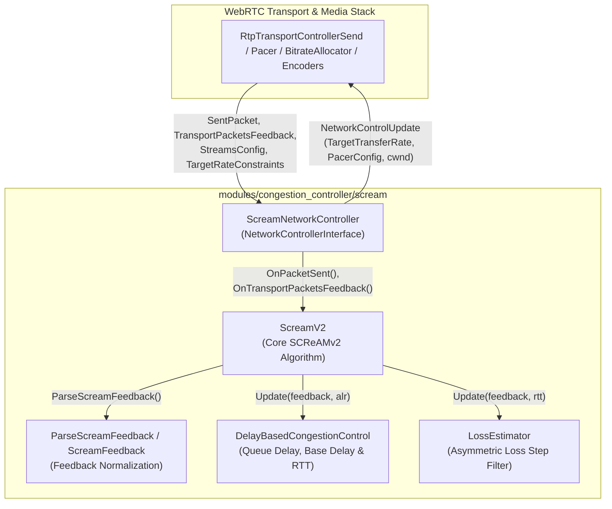

<!-- go/cmark -->

<!--* freshness: {owner: 'perkj' reviewed: '2026-10-12'} *-->

# SCReAMv2 Congestion Controller in WebRTC

This directory contains the WebRTC implementation of **SCReAMv2** (Self-Clocked
Rate Adaptation for Multimedia version 2), based on the IETF draft
[draft-ietf-ccwg-rfc8298bis-screamv2](https://datatracker.ietf.org/doc/draft-ietf-ccwg-rfc8298bis-screamv2/).

For a detailed section-by-section comparison between the IETF draft and the
WebRTC implementation, see
[implementation_diff.md](/modules/congestion_controller/scream/g3doc/implementation_diff.md).

[TOC]

## Architecture Overview

The implementation separates WebRTC transport integration
(`ScreamNetworkController`) from the core SCReAMv2 algorithm (`ScreamV2`) and
its signal-processing subcomponents (`ScreamFeedback`,
`DelayBasedCongestionControl`, and `LossEstimator`).

### Mapping to the SCReAMv2 Specification

The IETF draft divides the sender into three functional blocks (Section 3,
Figure 1):

1. **Network Congestion Control (Section 4.2):** Implemented by `ScreamV2`
   together with `ScreamFeedback`, `DelayBasedCongestionControl`, and
   `LossEstimator`. Computes the reference window (`ref_window_`) and L4S
   marking fraction (`l4s_alpha_`) from ECN-CE markings, queue delay, and packet
   loss.
2. **Sender Transmission Control (Section 4.3):** Split between `ScreamV2` and
   `ScreamNetworkController`. `ScreamV2` calculates `max_data_in_flight()` (the
   send window limit `ref_window * ref_wnd_overhead`) and `pacing_rate()`.
   `ScreamNetworkController` translates these into WebRTC's `congestion_window`
   and `PacerConfig` (including periodic padding and pacing burst windows).
3. **Media Rate Control (Section 4.4):** Split between `ScreamV2`,
   `ScreamNetworkController`, and WebRTC's `BitrateAllocator`.
   `ScreamV2::UpdateTargetRate()` computes a single aggregate target bitrate for
   the transport from `ref_window_` and smoothed RTT (plus receiver feedback
   hold time) and runs queue-draining logic. `ScreamNetworkController` applies
   pacer queue pushback (`cwnd_reduce_ratio`) and congestion-induced encoder
   pausing before emitting `TargetTransferRate`. Prioritizing and distributing
   this aggregate target bitrate across multiple media streams is delegated to
   WebRTC's external `BitrateAllocator`.

## Classes and Files

### `ScreamNetworkController`

**Files:**
[`scream_network_controller.h`](https://webrtc.googlesource.com/src/+/main/modules/congestion_controller/scream/scream_network_controller.h),
[`scream_network_controller.cc`](https://webrtc.googlesource.com/src/+/main/modules/congestion_controller/scream/scream_network_controller.cc)

Implements WebRTC's `NetworkControllerInterface` and adapts `ScreamV2` to the
WebRTC congestion control framework:

- **Lifecycle & Constraints:** Handles `OnNetworkAvailability`,
  `OnNetworkRouteChange`, `OnStreamsConfig`, `OnTargetRateConstraints`, and
  `OnRemoteBitrateReport`, forwarding effective min/max/start bitrate
  constraints to `ScreamV2`.
- **Packet & Feedback Events:** Forwards `OnSentPacket` and
  `OnTransportPacketsFeedback` to `ScreamV2` and emits a `NetworkControlUpdate`
  when target rate, bandwidth-limited state, pacer config, or congestion window
  changes.
- **Pacer & Probing Management:** Generates `PacerConfig` in
  `MaybeCreatePacerConfig()`. Adjusts the pacing burst window (`10 ms` after
  recent congestion vs. `default_pacing_window_`), triggers initial BWE probe
  clusters, and schedules periodic padding intervals when the send rate is below
  maximum allocated bitrate and no recent congestion has occurred.
- **Pacer Queue Pushback & Encoder Pause:** Computes `cwnd_reduce_ratio` in
  `[0.0, 1.0]` based on estimated pacer queue delay
  (`pacer_queue_size_ / pacing_rate`), and temporarily reports a zero target
  bitrate to pause encoders if `data_in_flight_ > max_data_in_flight()` while
  pacing delay exceeds `max_pacing_delay_for_pushback`.

### `ScreamV2`

**Files:**
[`scream_v2.h`](https://webrtc.googlesource.com/src/+/main/modules/congestion_controller/scream/scream_v2.h),
[`scream_v2.cc`](https://webrtc.googlesource.com/src/+/main/modules/congestion_controller/scream/scream_v2.cc)

Implements the core SCReAMv2 sender state machine:

- **Reference Window (`ref_window_`) & Inflection Point (`ref_window_i_`):**
  Updates `ref_window_` on every feedback report (`UpdateRefWindow()`). Reduces
  `ref_window_` on L4S ECN-CE (`l4s_alpha_`), virtual CE from queue delay
  (`l4s_alpha_v()`), or sustained packet loss (`beta_loss`), using non-linear
  backoff scaling (`ScaleBackoff()`) across the RTT. Increases `ref_window_`
  using an adaptive multiplicative/additive scale factor scaled by proximity to
  `ref_window_i_`, small-RTT ratio, post-congestion delay, and delay variation.
- **L4S Alpha (`l4s_alpha_`):** Tracks the EWMA of the ECN-CE marked packet
  fraction via a fast-attack, slow-decay filter (`UpdateL4SAlpha()`).
- **Application-Limited (ALR) Detection:** Tracks `max_data_in_flight` per RTT
  and sets `is_application_limited_` when
  `max_allowed_ref_window() < ref_window_` and
  `received_rate_ < alr_threshold * target_rate_`. In ALR, window growth is
  capped, RTT smoothing is slowed down, and feedback hold time updates are
  frozen.
- **Target Rate, Pacing Rate & Send Window:** Computes `target_rate()` from
  `ref_window_ / (rtt + feedback_hold_time_)` (with queue-drain halving if
  minimum queue delay stays elevated), `pacing_rate()` from `target_rate()` and
  `received_rate_`, and `max_data_in_flight()` (send window). Logs BWE updates
  via `RtcEventBweUpdateScream`.

### `ScreamFeedback` and `ParseScreamFeedback`

**Files:**
[`scream_feedback.h`](https://webrtc.googlesource.com/src/+/main/modules/congestion_controller/scream/scream_feedback.h),
[`scream_feedback.cc`](https://webrtc.googlesource.com/src/+/main/modules/congestion_controller/scream/scream_feedback.cc)

Normalizes WebRTC's `TransportPacketsFeedback` (typically derived from RFC 8888
RTCP Congestion Control Feedback) into a flat `ScreamFeedback` struct:

- **Byte & Packet Counters:** Aggregates `received` bytes,
  `acked_not_marked_size` (sum of sizes of non-CE packets in the feedback,
  including lost packets), `num_received_packets`, `num_ce_marked_packets`,
  `num_lost_packets` (first-time loss reports), and `num_recovered_packets`
  (out-of-order recoveries).
- **Burst-Windowed Delay Metrics (`DelayMetrics`):** Filters received packets
  with unambiguous receive times within a tail burst window (`burst_window_min`
  to `burst_window_max` from the latest sent packet) to compute
  `min_one_way_delay` and `max_one_way_delay` without bias from sparse earlier
  packets. Also extracts `rtt_sample`, `feedback_hold_time` (time between first
  and last packet arrival plus receiver hold offset), and
  `last_packet_receive_time`.

### `DelayBasedCongestionControl`

**Files:**
[`delay_based_congestion_control.h`](https://webrtc.googlesource.com/src/+/main/modules/congestion_controller/scream/delay_based_congestion_control.h),
[`delay_based_congestion_control.cc`](https://webrtc.googlesource.com/src/+/main/modules/congestion_controller/scream/delay_based_congestion_control.cc)

Estimates network queue delay, smoothed RTT, and delay-variation scaling factors
(Section 4.2.1.4 and Section 4.5.1):

- **Base Delay & Clock Drift Compensation:** Tracks the minimum one-way delay
  using a `WindowedMinFilter<TimeDelta>` (`base_delay_history_`, updated once
  per minute over a 10-minute window) following LEDBAT (RFC 6817).
- **Queue Delay & Virtual CE (`l4s_alpha_v`):** Computes `min_queue_delay`
  relative to the base delay and filters it with a slow-attack, fast-decay EWMA
  (`queue_delay_avg_`). Detects delay congestion when
  `queue_delay_avg_ > queue_delay_target / 2` and computes `l4s_alpha_v()` in
  `[0.0, 1.0]`.
- **Delay & Jitter Scaling Factors:** Computes
  `ref_window_scale_factor_due_to_avg_min_delay()` (from `queue_delay_min_avg_`)
  and `ref_window_scale_factor_due_to_latency_difference()` (from
  `max_one_way_delay - min_one_way_delay` within the feedback burst) to slow
  down window growth and tighten send-window overhead when standing queues or
  bottleneck saturation jitter are present.
- **Queue Drain Monitoring:** Tracks how long `min_queue_delay` stays above
  `queue_delay_drain_threshold` (`IsQueueDrainedInTime()`) and provides
  `ResetQueueDelay()` if draining fails.

### `LossEstimator`

**Files:**
[`loss_estimator.h`](https://webrtc.googlesource.com/src/+/main/modules/congestion_controller/scream/loss_estimator.h),
[`loss_estimator.cc`](https://webrtc.googlesource.com/src/+/main/modules/congestion_controller/scream/loss_estimator.cc)

Estimates short-term loss congestion while filtering out reordering and random
non-congestion link-layer losses:

- **Reordering Recovery Tracking:** Tracks `unrecovered_lost_packets_`,
  incrementing on new losses and decrementing if subsequent feedback reports
  packets as recovered. If all lost packets are recovered, `congestion_level_`
  resets to `0.0`.
- **Biased Asymmetric Step Filter:** Updates `congestion_level_` in `[0.0, 1.0]`
  at RTT boundaries (`max(virtual_rtt, rtt)`). Steps up by
  `1.0 / rtts_with_loss_before_backoff` (default `+1/3`) on an RTT with loss,
  and steps down by `1.0 / lossless_rtts_before_clear` (default `-1/2`) on a
  lossless RTT. This gives a negative drift under low uniform random loss while
  triggering `congested()` (`>= 0.99`) after 3 consecutive lossy RTTs and
  blocking window increases while `congestion_level_ >= 0.01`.

### `ScreamV2Parameters`

**Files:**
[`scream_v2_parameters.h`](https://webrtc.googlesource.com/src/+/main/modules/congestion_controller/scream/scream_v2_parameters.h),
[`scream_v2_parameters.cc`](https://webrtc.googlesource.com/src/+/main/modules/congestion_controller/scream/scream_v2_parameters.cc)

Defines all configurable constants and thresholds for the SCReAMv2 module,
parsed from the `WebRTC-Bwe-ScreamV2` field trial string via
`FieldTrialParameter<T>`.
